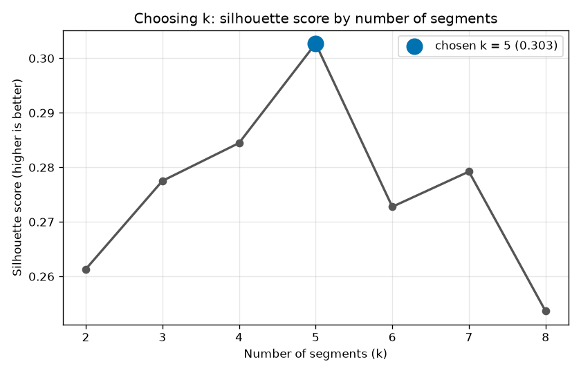
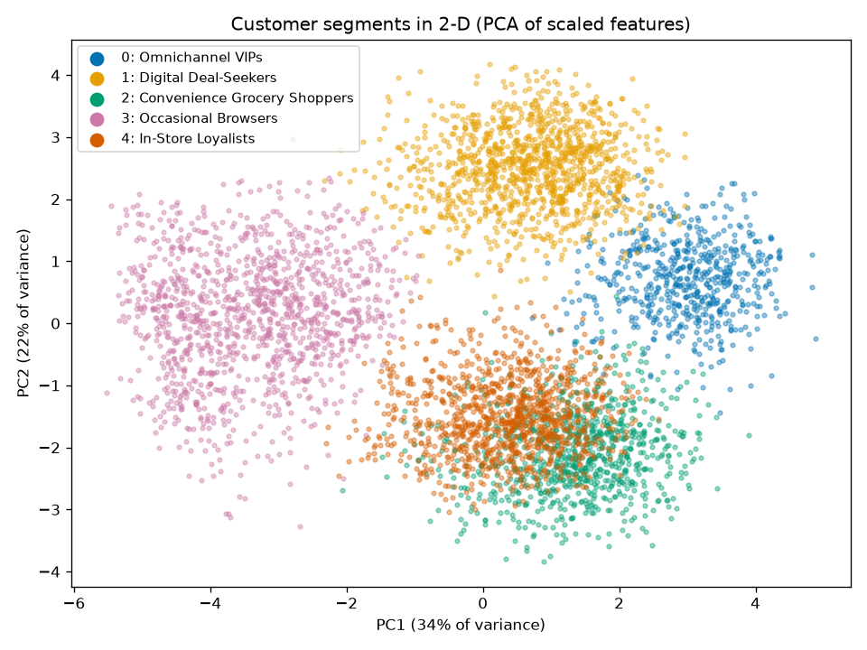
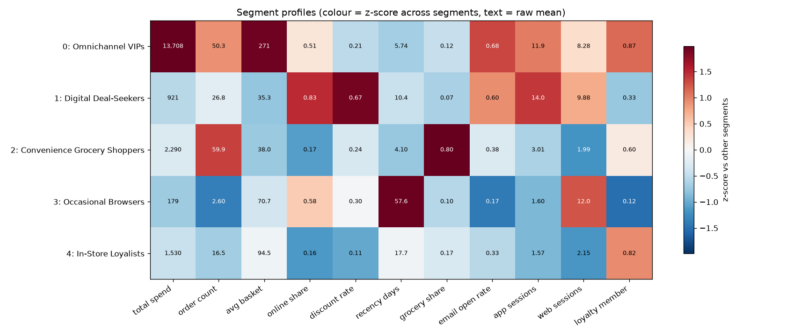
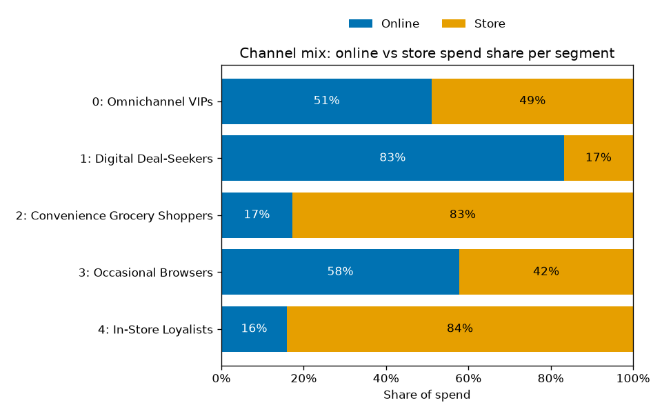

# REPORT: Omnichannel Customer Segmentation

## What was built

A small, fully reproducible pipeline that:

1. **Generates** fake retail data for 5,000 customers: 136,447 transactions (online or in store) plus email/app/web engagement. Five customer "types" are planted in the data, and only a separate answer-key file (`data/ground_truth.csv`) records which type each customer is.
2. **Builds 15 features** per customer, such as total spend, online share, discount rate, recency and grocery share.
3. **Log-transforms and standardizes** those features, then runs **KMeans** for k = 2..8 and **picks k by silhouette score**.
4. **Profiles and names** each segment with simple if/else rules on the segment averages.
5. **Grades itself** against the hidden answer key with the Adjusted Rand Index (ARI). This is possible only because the data is synthetic.
6. **Draws 4 charts** and writes `outputs/metrics.json`, `outputs/segment_profiles.csv` and `outputs/customer_segments.csv`.

Run it with `.venv/bin/python run_all.py`. To learn how it works, read [LEARNING_GUIDE.md](LEARNING_GUIDE.md).

## Final metrics (seed 42)

| Metric | Value | Target in SPEC |
|---|---|---|
| Chosen k | **5** | 5 ± 1 |
| Silhouette (k = 5) | **0.303** | ≥ 0.15 |
| ARI vs hidden truth | **0.941** | ≥ 0.70 |
| Pipeline runtime | **about 2–3.5 s** (`runtime_seconds` was 1.93, 3.2 and 3.42 on three runs; it changes on every run) | < 120 s |
| Tests | **68 passed** (`pytest -q` reported 13.9 s; 14.3 s wall clock) | all pass, < 60 s |
| Acceptance criteria | **14 / 14 PASS** (see `REVIEW.md`) | |

Silhouette for every k tried (from `metrics.json`):

| k | 2 | 3 | 4 | **5** | 6 | 7 | 8 |
|---|---|---|---|---|---|---|---|
| silhouette | 0.261 | 0.278 | 0.284 | **0.303** | 0.273 | 0.279 | 0.254 |

## The segments

Numbers are segment averages from `outputs/segment_profiles.csv`. Spend is per customer per year.

| # | Name | Size | Share | What makes it distinct |
|---|---|---|---|---|
| 0 | Omnichannel VIPs | 597 | 11.9% | By far the biggest spenders (≈ $13,700 a year, average basket ≈ $271, ≈ 50 orders). They split spend evenly between online and store (51% online). 87% are loyalty members and they open the most emails (0.68). |
| 1 | Digital Deal-Seekers | 1,180 | 23.6% | 83% of spend is online. They use a discount on 67% of orders, have the highest app use (≈ 14 sessions/month) and buy small baskets (≈ $35). |
| 2 | Convenience Grocery Shoppers | 890 | 17.8% | 80% of spend is grocery. They are the most frequent buyers (≈ 60 orders), shop mostly in store (17% online) and bought most recently (≈ 4 days ago). |
| 3 | Occasional Browsers | 1,225 | 24.5% | Only ≈ 2.6 orders and ≈ $179 a year, and the longest gap since the last purchase (≈ 58 days). They visit the website a lot (≈ 12 sessions/month), but rarely open emails (0.17) or join loyalty (12%). |
| 4 | In-Store Loyalists | 1,108 | 22.2% | Mostly in store (16% online), with few discounts (11%) and 82% loyalty membership. Baskets are mid-sized (≈ $94) and digital engagement is low. |

The names come from fixed rules in `evaluate.py:_name_one`, not from the answer key. All five clusters line up with the five planted types (ARI 0.941).

## Charts

### Choosing k

The silhouette score peaks clearly at k = 5 (0.303). The next best values are k = 4 (0.284) and k = 7 (0.279).

### Segments in 2-D

When the 15 scaled features are squeezed down to 2 PCA dimensions (34% + 22% of the variance), Browsers, Deal-Seekers and VIPs form separate clouds. In-Store Loyalists and Grocery Shoppers overlap in this 2-D view. They are separated in the full 15-D space, mainly by grocery share.

### Segment profiles

Each row is a segment. The colour shows how far that segment's average sits above (red) or below (blue) the other segments, and the text gives the raw average. The dark-red cells show each segment's signature trait: VIP spend and basket size, Deal-Seeker online share and discounts, Grocery share, Browser recency.

### Channel mix

Online share of spend ranges from 83% (Digital Deal-Seekers) down to 16–17% (In-Store Loyalists and Grocery Shoppers). VIPs (51%) and Browsers (58%) sit in between.

## Mutation check

The reviewer deliberately broke a copy of the code in four ways to see whether the tests would notice. **All 4 mutations were caught** (details in `REVIEW.md` §2):

| Mutation | Caught by |
|---|---|
| Shuffle feature rows before clustering | `test_evaluate.py::test_pipeline_ari_at_least_0_70` (ARI fell to ≈ 0) |
| Hard-code k = 2 | `test_cluster.py::test_chosen_k_is_five_plus_minus_one` |
| Remove scaling | `test_cluster.py::test_chosen_k_is_five_plus_minus_one` (and the scaling tests in `test_features.py`) |
| Generator ignores the seed | `test_generate_data.py::test_same_seed_gives_identical_data` |

## Known issues / limitations

- **Synthetic data.** The segments were planted with clear differences on purpose. Real customers are messier, so expect a lower silhouette and a less clear choice of k on real data.
- **ARI is only possible because we know the truth.** On real data there is no answer key. You would judge segments by silhouette, stability across seeds and whether the business finds them useful.
- **The silhouette margin is small.** k = 5 scores 0.303 and k = 6 scores 0.273, a gap of 0.030. The runner-up is actually k = 4 (0.284, a gap of 0.018). A modest change to the data could shift the chosen k by one, which is why the spec accepts 5 ± 1.
- **Recency is measured against the latest date in the data**, not against "today" (on purpose, for reproducibility).
- **The first slow pytest run had nothing to do with the tests.** One `pytest -q` run took 375 s of wall time even though pytest itself reported 17.6 s, while the machine was busy with other work. Run alone, it took 14.3 s.
- LOW items from `REVIEW.md`:
  - `test_run_all_script_end_to_end` runs the real script, so every `pytest` run overwrites the project's `data/` and `outputs/` (this is also why `runtime_seconds` keeps changing).
  - The chart tests only check that each file exists and is non-empty, not what the chart shows or that figures are closed.
  - `test_dates_within_history_window` allows one day more than the strict 365-day window. The generator itself stays inside the window.
  - Seed stability (A10) is tested with only one alternative seed (7). Seed 123 was checked by hand (ARI 1.0).
  - `run_all.print_summary` always prints `config.OUTPUT_DIR`, not the `output_dir` actually used. This is harmless today because `main()` uses the defaults.
  - `visualize.plot_pca_segments` has an extra optional `names=None` keyword that the spec does not list. It is backward compatible.
  - The reviewer could not use git to confirm that tests were not edited after phase 1.
